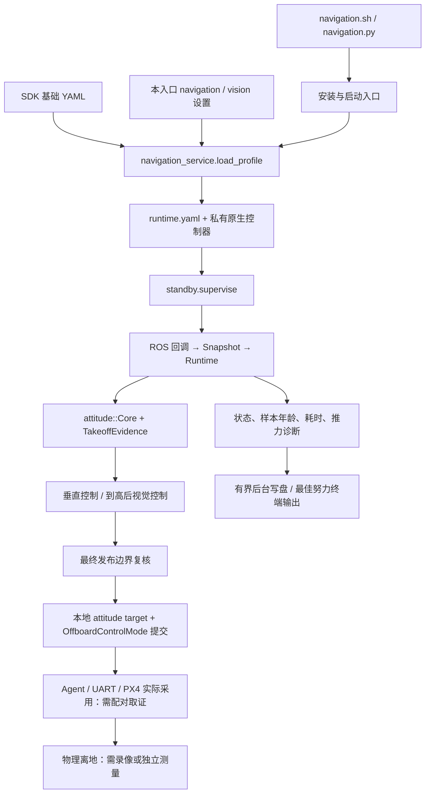

# 2026-11-03 起飞、重准备与通信交付审查

本轮把导航初始平台默认统一为 **相对本次地面基准向上 1.5 m**，修复离地证据的异步汇合、到高前导航准入和正常落地后的进程内重准备，并补齐推力、反馈与循环耗时记录。控制器计算、Linux 本地发布、PX4 接收采用、真实物理离地分别取证。现有资料不能证明当前香橙派故障由串口饱和或推力不足造成，也不能证明本版已经实飞通过。

工作分支为 `fix/takeoff-readiness-20261103`，基线是视觉开发提交 `28bdf958abddc29200319b5877d617f856b96c14`；更早导航修复为 `6b440ab`。用户确认香橙派已装视觉开发版，但本轮没有 SSH，也没有新失败窗口的香橙派日志与 PX4 ULog 配对。本轮未切换香橙派服务、修改飞控参数、打开串口或执行动力动作。`/home/orangepi/FC01_OrangePi_Navigation_20261031_fixed` 是旧部署路径，不能作为当前运行进程的身份或行为证据。

## 阅读入口与源码地图

| 内容 | 入口 |
|---|---|
| 起飞证据汇合、样本与持续时间 | [takeoff_evidence.hpp](../native/src/jikl_fc01_system/include/jikl_fc01_system/takeoff_evidence.hpp) |
| 配置/反馈/阶段/输出类型与纯谓词（纯结构提取） | [attitude_types.hpp](../native/src/jikl_fc01_system/include/jikl_fc01_system/attitude_types.hpp) |
| 参数、反馈与阶段类型 | [attitude_types.hpp](../native/src/jikl_fc01_system/include/jikl_fc01_system/attitude_types.hpp) |
| 阶段、唯一地面高度基准、升降及视觉准入 | [attitude_altitude_core.hpp](../native/src/jikl_fc01_system/include/jikl_fc01_system/attitude_altitude_core.hpp) |
| RC 新授权、零推力预发送、准备失败白名单 | [rc_navigation.hpp](../native/src/jikl_fc01_system/include/jikl_fc01_system/rc_navigation.hpp) |
| 任务重准备、命令事务和 ACK 隔离 | [runtime.hpp](../native/src/jikl_fc01_system/include/jikl_fc01_system/runtime.hpp) |
| 最终发布复核 | [publication_guard.hpp](../native/src/jikl_fc01_system/include/jikl_fc01_system/publication_guard.hpp) |
| ROS 适配、状态字段、发布结果和周期记录 | [fc01_system_node.cpp](../native/src/jikl_fc01_system/src/fc01_system_node.cpp)、[control_diagnostics.hpp](../native/src/jikl_fc01_system/include/jikl_fc01_system/control_diagnostics.hpp) |
| Python 默认、配置叠加与后台状态写盘 | [fc01_control.py](../fc01_control.py)、[navigation_service.py](../navigation_service.py)、[standby.py](../standby.py) |
| 当前配置与只读采集 | [基础 YAML](../native/config/attitude_altitude.yaml)、[入口设置](../navigation_settings.json)、[navigation_collect.py](../navigation_collect.py) |
| 通信历史、115200 预算与 UART6 核实项 | [通信审计](COMMUNICATIONS_AUDIT_20261103.md) |
| 设计与执行边界 | [设计](superpowers/specs/2026-11-03-takeoff-readiness-design.md)、[执行计划](superpowers/plans/2026-11-03-takeoff-readiness.md) |



Python 负责配置、监督和观察；飞行设定值由原生控制器发布。`flight_started` 从本次任务取得控制职责时开始，包含尚未离地的阶段，不能读成“已飞起来”。

## 已确认问题与尚未证实原因

| 观察或问题 | 证据与处理 | 仍不能据此断言 |
|---|---|---|
| 默认平台高度在入口、导出和离线回放中不一致 | 集中 `DEFAULT_TAKEOFF_HEIGHT_M=1.5`，贯通设置缺省、C++ 参数、配置导出、CLI 和回放初始高度；显式设置仍可配置 | 香橙派当前运行参数已变成 1.5 m |
| `landed` 与原始位置样本异步到达，单次组合可能消耗有效检测事件 | 两路独立保留来源序列，在有界时间内汇合；覆盖检测先到、位置先到、慢检测、单点、冻结和回退 | 两路估计共同漂移已排除 |
| 起飞过程状态与“到高、可导航”语义混淆 | 分离 `takeoff_stage`、`liftoff_confirmed`、`target_height_settled`、`navigation_allowed`；离地且到高稳定后才用视觉运动 | 解锁、推力到某值、PX4 takeoff detected 等于物理离地 |
| 准备阶段串联重复地面等待 | 已有连续 2 s 地面证据时直接进入实际预发送，不再增加第二个 2 s；保留 1.2 s 已提交零推力预发送和新的 RC 授权 | 预发送、PX4 反馈或人工授权可以省略 |
| 正常落地后下一轮准备依赖进程退出 | 安全准入后只重建任务 Core，保留 Runtime 命令代次、历史和 ACK 因果水位 | 所有故障都能自动恢复，或旧 ACK 可复用 |
| 状态落盘或终端阻塞可表现为“等待、不刷新” | 状态队列 1、转换日志队列 16、限时关闭；真实 PIPE 和 journal socket 的输出使用非阻塞写法 | 已证明现场串口堵塞或循环停顿 |
| 历史 UART 完整话题预算超过 115200 容量 | 详见[通信审计](COMMUNICATIONS_AUDIT_20261103.md)，已有固件限流与本地构建证据 | 当前已装镜像、当前负载、当前失败与那份历史模型相同 |

本轮保留局部修复和小范围提取，保留既有垂直控制器、RC 授权、停桨证据及最终双发布边界。PID、推力基线、失控保护阈值没有因“可能推力不足”而放宽。

## 阶段、阈值与证据矩阵

相对高度使用 `h=z0-z_NED`，向上速度使用 `up_v=-vz_NED`。`z0` 来自本次任务的新鲜安全地面准入；同一任务重复命令不重建基准。来源时间戳使用 PX4 时间域，本地持续时间使用 monotonic 时间；两者分别检查，不能互相替代。

| 阶段 / 字段 | 准入或退出证据 | 默认阈值及行为 |
|---|---|---|
| 地面准备 / `NOT_STARTED` | 未解锁、landed、at_rest、稳定模式、杆位安全、RC 来源有效、健康反馈、连续静止 | 地面 2 s，`|vz|≤0.1 m/s`；不重复等待第二个 2 s |
| `RC_PRESTREAM` / `NOT_STARTED` | 真实本地成功提交的零推力目标和心跳，PX4 Offboard signal 未丢失 | 1.2 s；提交数不少于 `ceil(loop_hz×1.2×0.8)`，20 Hz 时为 20 次；阻塞/拒绝发布不能充数 |
| `RC_READY_WAIT_ARM` / `NOT_STARTED` | 准备完成后产生的新 CH5 手动解锁边沿，加匹配的新 Armed 状态与 RC 解锁原因 | 准备前产生、延迟到达的开关事件不算授权；程序 `arm_enabled=false` |
| `RC_ARMED_WAIT_NAVIGATION` | 新解锁事件后再选择导航档，状态、模式与本次解锁 episode 匹配 | 手动解锁证据超时 2.5 s；选择导航超时 8 s；超期 tick 不能补成成功 |
| `ARMED_GROUND` | 已确认本次解锁、Offboard 和地面稳定，保持既有授权及健康检查 | 动力地面观察 1 s；不是离地证据 |
| `THRUST_RAMP` / `LIFTOFF_UNCONFIRMED` | 受限推力爬升并观察独立检测与位置序列 | ramp 2 s；到达悬停/保留推力或经过时间均不能确认离地 |
| `liftoff_confirmed=true` | 新的 `!landed` 检测序列与原始 local sample 上升序列汇合；两路各至少 2 个来源推进样本 | 各自来源与接收持续时间均 ≥0.20 s；`h≥0.12 m`，`up_v≥0.08 m/s`，真实样本高度增量 ≥`0.08×0.20=0.016 m` |
| `CLIMBING` / `ASCEND` | 已有本次离地证据，垂直反馈与边界继续有效 | 目标默认 1.5 m；最大爬升 0.3 m/s，上升时限 10 s；超时进入受控下降 |
| `TARGET_SETTLED` / `HEIGHT_HOLD` | 已离地，命令高度已到目标，`!landed`、高度和速度误差持续合格 | `|h-target|≤0.15 m`、`|up_v|≤0.15 m/s`，连续 2 s；此时 `navigation_allowed=true` |
| `LANDING` | 主动降落、视觉请求、超时或飞行中 landed 矛盾；撤销视觉运动并保留健康受控下降 | 最大下降 0.2 m/s；新的 landed 样本、近地高度/速度及既有接地持续时间继续复核 |
| `COMPLETE` / 再准备 | 正常完成或白名单准备失败；新鲜未解锁安全地面、已退出 Offboard、控制复位、输出停止、无未决命令 | 进程保留，下一轮必须重新取得地面、预发送及 RC 授权证据 |
| `FAULT` | 严重发布、时钟、估计器或其他非白名单故障 | 不自动清除，不把 retry 当成恢复证明 |

离地汇合还要求 local 新鲜度 ≤0.5 s、land 新鲜度 ≤2.5 s；检测序列来源与接收最大间隔为 `min(1.25,2.5/2)=1.25 s`。原始 local 样本冻结、来源回退、接收时间回退、超龄、检测反弹为 landed 都会清理相应证据。上升段可桥接短暂刹停以等待慢检测；其有效期从**实际测得向上运动**起最多 2.5 s，新信封携带固定高度不能无限续期。

`liftoff_confirmed` 记录本轮曾经通过的内部离地证据，降落过程中仍可为 true；它不是当前接触状态。`target_height_settled` 与 `navigation_allowed` 跟随当前阶段，退出高度保持就撤销。Core 在爬升/高度保持收到 landed 矛盾时立即停止视觉、转受控下降；最终发布端还会挡住计划之后才到达的 landed 矛盾。**单一矛盾检测不授权停桨**，实际 Disarm 仍须原有新的接地、状态和命令因果证据。

1.5 m、0.3 m/s 和 2 s 稳定窗口在离线轨迹中可检查时序，但模型未覆盖真实机体的全部动力学；不能据此保证在当前机体与当前反馈延迟下必然满足上升时限。

## 配置来源、安装与当前运行身份

| 对象 | 用途与边界 |
|---|---|
| 仓库 `native/config/attitude_altitude.yaml` | 本版基础参数；缺省仍关闭飞行动作、Arm、起飞及参数确认门。1.5 m 默认不等于打开动力许可 |
| `FC01_PROJECT_ROOT/config/attitude_altitude.yaml` | 设备原 SDK 工程提供的基础 YAML，安装入口从这里加载；不能假设其内容已与本仓文件一致 |
| 本入口 `navigation_settings.json` / `vision_settings.json` | 叠加导航高度、档位与视觉设置；旧显式高度不会被缺省值偷偷覆盖，升级时须核对实际生成结果 |
| 生成的 `runtime.yaml` | 本次启动实际传入 `--params-file` 的候选配置；须由同次安装的真实 `fc01_config_check` 读取 |
| 入口私有安装 `.build/<key>/install` / `install` | `navigation.sh → navigation_boot.sh → navigation_service.py` 使用本入口构建安装的私有控制器；与 SDK 中旧二进制分开。环境检查核对实际要启动的控制器 |
| legacy `start.sh → launcher.py` 控制台入口 | 缺省仍调用 SDK `install_r632` 中的控制器；launcher 默认高度也改为 1.5 m，但只有重新构建且带本版标识的 ELF 才含新起飞状态机。修改仓库源码不等于 SDK 旧 ELF 已升级 |
| `/proc/PID/exe`、argv、service WorkingDirectory / ExecStart | 当前运行身份的证据；磁盘上有源码、ZIP 或二进制不证明进程已加载它 |

默认 1.5 m 已贯通 Python 公用常量、导航设置缺省、C++ Config/ROS 参数、基础 YAML、配置导出、CLI 和离线回放初始平台。高度容差、反馈超时、增益、测试采样等同为 `0.5` 的非目标高度数值保留。明确设置其他合法高度仍生效。

导航 profile 仍使用 `manual_arm_only=true` 的授权模型：`arm_enabled=false`，RC 手动解锁；视觉开关不改变这项约束。原生二进制新增 `NAV_TAKEOFF_EVIDENCE_V2_20261103` 标识，安装检查拒绝缺此标识的旧导航控制器，避免只更新 Python 后误用旧程序。

## 推力的四层证据

| 层级 | 本版记录 / 已有证据 | 可证明范围 |
|---|---|---|
| 1. 控制计算 | P/I、raw thrust、速度/高度目标、closed loop、takeoff ceiling | 控制器算出了什么 |
| 2. 限幅和本地提交 | `saturated`、`slew_limited`、`takeoff_thrust_limited`、计划推力；target/heartbeat 本地提交次数、时间及异常 | 最终边界允许了什么，rclcpp 本地 publish 是否返回；不证明到达 PX4 |
| 3. PX4 内部采用 | 需要同窗 ULog 的 `vehicle_attitude_setpoint`、`vehicle_thrust_setpoint`、控制模式与飞行状态 | PX4 内部相应设定值和模式；不能仅靠香橙派本地 commit 声称采用 |
| 4. 物理响应 | 同步录像、目视记录或独立测距 | 真实离地、离地高度和机体响应；PX4 内部估计不能独立替代 |

本轮不改原推力候选：hover `0.475`，起飞 reserve `0.04`，离地前上限 `0.515`；min/max `0.12/0.75`，slew `0.40/s`，高度/速度/I 增益 `0.50/0.15/0.03`，I 限值 `0.08`。这些沿用工程候选，未完成当前机体标定。机体系向上推力表现为负的 `thrust_body[2]`，不能把 `-0.475` 误读成无推力。

新增状态故意保留 `px4_thrust_adoption=UNOBSERVED` 和 `physical_liftoff=EXTERNAL_OBSERVATION_REQUIRED`，避免把本地成功发布升级成实机结论。

## 历史 ULog 的可用结论

解析源是 `/home/jikl62/桌面/log_96_2026-10-31-17-52-00.ulg`，SHA-256 为 `2286de041e9e0cae7fab7c2cd28d2d7b64e80e53df9fa83805da77487a350ad4`。结构化证据见 [20261103_ulog_summary.json](evidence/20261103_ulog_summary.json)。记录约 17.18 s，板型 `DAMIAO_DM_FC01`，PX4 hash `07983bfb894b9372d7520d43ac10dc792d0b4b9f`。

| 相对日志时间 | PX4 内部观察 |
|---|---|
| 约 0 s | RC switch 解锁 |
| 5.234 s | Offboard 控制启用 |
| 7.034 / 7.043 s | `landed=false` / commander `Takeoff detected` |
| 9.978 s | 日志中最后一条 `offboard_control_mode` |
| 10.053 s | Offboard 控制关闭、failsafe 激活；该日志参数 `COM_OF_LOSS_T=1.0 s` |
| 14.167 / 14.176 s | `landed=true` / `Landing detected` |
| 16.185 s | landing 触发 Disarm |

两个推力设定值话题都记录到约 `-0.47513685`；因此“PX4 从未得到任何非零推力”与这份历史记录不符。local z 范围约 1.126 m、复位计数在该窗口内不变，仍然只是估计器输出，不能单独证明实飞。日志中的最后心跳记录与随后 failsafe 在时序上相关，单凭 logger 最后记录不能证明真实停发时刻；缺少配对香橙派日志，无法定位是应用主动撤销、进程/循环、发布边界、链路还是其他原因。ULog 话题记录频率是 logger 频率，不是实测 UART 吞吐；15.714 s 的 timesync RTT 31 ms 也不能证明 10 s 时串口饱和。

## 等待、retry 与观测

等待分为地面证据、真实预发送、RC 新授权、PX4 新状态/ACK、反馈样本和后台 I/O。减少重复地面 dwell 不改变这些证据的先后关系。正常落地后调用 `Runtime::reprepare_rc`，只重建任务 Core，清本轮视觉/高度/RC 任务状态，Runtime 的 wire generation、命令历史、ACK 水位和本地提交因果证据继续保留。已计划、已超时但未解决的事务不能只凭 timeout 视为终结。

允许重试的准备原因使用显式白名单，包括 RC 手动解锁证据、导航选择或导航确认超时等可恢复准备失败。新鲜健康地面、未解锁、稳定模式、退出 Offboard、杆位与辅助开关复位、输出停止、无维护/停机锁存、无发布/时钟故障等条件缺一不可；严重故障不自清。下一轮的新开关边沿不能由上一轮状态、视觉指令或旧 ACK 代替。已过期的视觉缓存不能续用；如果上游持续发布同一旧目标但时间戳持续更新，当前按有效新输入处理，任务 ID 与“是否跨任务沿用”仍需与视觉/规划方明确。

原生控制循环继续执行 `spin_some → tick → sleep_until`，记录上周期 callbacks、control、period、最大 period 和超过 `0.3 s` 的 stall 次数。状态同时给出接收年龄、信封来源年龄和 local/attitude 原始 `timestamp_sample` 年龄，便于区分“收到新信封但原始样本未推进”。这些年龄依赖正确的时间域映射；负值、无效时钟或 unknown 不应被读成零延迟。

Python 状态落盘改为后台队列：保留最新 1 个快照、最多 16 条待写转换消息，关闭默认最多等待 0.2 s。终端输出对 PIPE 独立打开非阻塞描述符，对 journal socket 使用单次 `MSG_DONTWAIT`，不会修改共享 stdout 的阻塞属性；队列拥塞可替换旧项，所以它不是每个控制 tick 的完整录波。磁盘写错时局部 handler 通过非阻塞 stderr 报告并记录错误次数，避免标准 logging 异常处理再次卡住退出；状态中的 `status_log_write_errors/status_log_last_error` 可见存储失败。已有原生有界异步日志和非阻塞 IPC 保留。导航服务显式关闭 CSV；legacy 控制台模式的 CSV 同步 flush 仍存在，不能宣称所有入口已排除写盘阻塞。

## 最小实机只读取证

先在**当前已部署入口目录**执行以下命令，输出目录必须尚不存在；不要从旧部署路径推定当前服务来源：

```bash
python3 navigation_collect.py --output ~/FC01_readonly_20261103
```

若需同步 ROS 窗口，在与实际 service 一致的 Humble/SDK 环境中执行，以下 SDK 路径与 Domain 值须按首份报告核对：

```bash
source /opt/ros/humble/setup.bash
source /实际工程路径/install_r632/local_setup.bash
ROS_DOMAIN_ID=0 ROS_LOCALHOST_ONLY=0 python3 navigation_collect.py \
  --output ~/FC01_readonly_ros_20261103 --ros-seconds 10
```

采集器不启动/停止 Agent、节点或服务，不连接控制 IPC，不打开串口，不改参数，不创建 `/fmu/in` 发布者。它读取 service、`/proc`、实际 exe/config 哈希、Domain/SDK 相关环境与 UART 占用；可选 ROS 子进程只被动订阅 9 个关键输出话题，报告 Hz、来源/原始样本年龄、重复/回退、端点 QoS 与 CDR 尺寸。缺权限、缺依赖、超时与身份不明都记 unknown。CDR B/s 不能直接当 UART 线上 B/s。

在现有 FC01 NSH 控制台取同窗开始/结束的只读状态，无需创建新串口连接：

```text
ver all
uxrce_dds_client status
param show UXRCE_DDS_CFG
param show UXRCE_DDS_DOM_ID
param show SER_TEL3_BAUD
uorb top
```

两侧报告要与同一失败窗口的原生状态/日志、原始 ULog 一起保留；时间基准、进程 PID/实际 exe、runtime YAML 与固件身份要能配对。若要验收物理离地，再加独立录像/测距与清晰时间标记。以上命令本身不授权起飞，也不能从没有发生的动力动作得出离地结论。

通信容量、Agent 冲突、消息版本、Domain/QoS、时钟、终端/写盘和控制等待应按[通信审计](COMMUNICATIONS_AUDIT_20261103.md)分层核实。UART6 的 FC01 侧映射已查到 `/dev/ttyS5`，但针序、电平、占用、当前镜像能力未绑定；读取的定制 uXRCE 为单实例，没有逐话题跨双串口分流能力。仅多开 Linux Agent 不能形成第二个飞控发送源，因此本轮没有接线或启用 UART6。

仍待实机确认：实际部署路径和二进制、实际 runtime 1.5 m 与视觉开关、当前固件及消息 SDK、两向串口字节/丢帧、源样本推进和控制周期、PX4 实际采用、到高窗口、正常落地后第二轮新授权，以及独立物理离地。不能用开发机或历史日志代填这些项目。

## 构建、回归与交付状态

| 验证 | 本轮事实与范围 |
|---|---|
| 原基线 | `python3 -m unittest discover -s tests -v`：160/160，通过；日志 `/tmp/fc01_1103_baseline_tests.log` |
| 新增针对性回归 | 覆盖异步离地/冻结/反弹/证据过期、RC 阶段与到高门、reprepare 准入/旧 ACK、配置一致性、后台输出/写盘、只读采集；对应 `native/tests/test_takeoff_evidence.cpp`、`test_rc_takeoff_stage.cpp`、`test_rc_reprepare_admission.cpp` 与 Python 新用例 |
| 完整回归最终统计 | **182/182，通过，32.347 s**；日志 `/tmp/fc01_1103_release_tests.log`。两个旧 fixture 的来源时序操纵同步为真实 50 ms 增量，拒绝条件保留；新增真实满 PIPE/journal、磁盘写错+满 stderr 测试通过 |
| 原生 C++ 回归 | `python3 tests/run_native_cpp.py`，`-std=c++17 -Wall -Wextra -Werror -pedantic -pthread`；**60/60 个程序通过**（由上述完整回归执行） |
| 真实 ROS 构建 | 开发机 x86 的真实 Humble + 现有 FC01 `px4_msgs` 构建并安装到 `/tmp/fc01_takeoff_ros_20261103/install`；`ldd` 无 missing。最终重构后构建日志 `/tmp/fc01_1103_verified_build.log`；不是 ARM64 或香橙派部署验收 |
| 真实参数消费者 | 视觉开/关两份导出的 runtime YAML 经真实 `fc01_config_check` 读取，均为 `manual_arm_only=true`、`rc_target_height=1.5`；文件 `/tmp/fc01_1103_runtime_on.yaml`、`/tmp/fc01_1103_runtime_off.yaml` |
| 采集器 | 9 项局部回归与隔离 Domain214 的真实 Humble/原 SDK 合成消息烟测通过；未连接 Agent/飞控，细节见[通信审计](COMMUNICATIONS_AUDIT_20261103.md) |
| 合成人为反馈全链路 | [记录及范围](evidence/20261103_synthetic_takeoff_trace.json)、[可重现记录器](evidence/20261103_synthetic_takeoff_trace.cpp)：两轮 1.5 m 起飞/导航准入/降落/上锁，822 次 Runtime step、819 组最终本地双 sink、两次 Disarm 代际 1→2；无自动 Arm/Offboard。**使用测试 fixture 参数**，有效值写在 JSON 中，不等同于生产候选参数验证 |
| 当前 YAML 参数闭环回放 | [模型结果](evidence/20261103_replay_summary.json)：cruise/height 各 180 行双 sink 通过；9 s cruise XY 误差 0.8944→0.0008514 m，height 从 1.5 m 向 1.9 m 指令达到 1.9201 m。使用理想模型且起飞预热反馈为人为设定，不代表真实性能 |
| 实机动力与部署 | 未执行，待配对只读取证与独立物理观察 |

本轮开发机已能使用真实 Humble；其他旧文档中“主机缺少真实 Humble”的陈述只描述当时验证环境，不能覆盖本轮构建事实。真实构建解决链接与消息兼容性这一层，不能替代设备 ARM64 构建、service 身份或飞行验证。

复现核心检查：

```bash
python3 -m unittest discover -s tests -v
python3 vision_replay.py --demo cruise > /tmp/fc01_cruise.jsonl
python3 vision_replay.py --demo height > /tmp/fc01_height.jsonl
```

真实 Humble 构建命令沿用 [视觉工程构建方法](VISION_NAVIGATION.md)，将其 `/tmp/fc01_vision_ros_20261031` 换为本轮 `/tmp/fc01_takeoff_ros_20261103`；不得把主机 x86 产物复制到 ARM64 运行。

## 提交、合并与回退

行为修复、配置/观测和通信文档先形成可审阅提交；纯结构提取另起提交，便于比较行为边界。本轮将既有 Config/Feedback/Phase/Output 与纯谓词 212 行提取到 `attitude_types.hpp`，Core 经 include 继续暴露这些类型，未借此修改行为。Core 的重复 vertical sample 构造统一到一处，节点直接读取 Core 的唯一高度基准，移除 RC 重复地面计时器，并将普通诊断从每个 20 Hz tick 减至 2 Hz（阶段转换仍立即记录）。原有故障/bench/legacy 控制分支缺少可证明无用的证据，因此保留。

| 项目 | 记录 |
|---|---|
| 行为修复提交 | 待收尾填写 |
| 纯结构提取提交 | 待收尾填写 |
| 交付归档与 SHA-256 | 待收尾填写 |
| 主线状态 | 本轮工作分支交付；未自动合并主线或切换设备服务 |

合并审查以 `28bdf95` 视觉开发为基线，确认保留视觉接口与到高门，核对完整回归、真实构建和实际生成 YAML。保留用户已有 `native/src/jikl_fc01_system/src/fc01_config_check.cpp` 空白改动，不纳本轮提交。可用以下只读命令审查提交与工作区：

```bash
git log --oneline 28bdf958abddc29200319b5877d617f856b96c14..fix/takeoff-readiness-20261103
git diff --stat 28bdf958abddc29200319b5877d617f856b96c14..fix/takeoff-readiness-20261103
git status --short
```

主线合并和香橙派安装是两个独立步骤。部署前保留当前实际 service/unit、已加载二进制与 runtime YAML 指纹，先用候选安装的真实 checker 验证配置；设备版本未绑定前不能把旧目录名当回退点。源码回退可逐提交 `git revert`，结构提交可独立撤销；设备回退须恢复经过指纹确认的旧 service/安装/config 组合。由于本轮没有切换设备，当前设备状态没有本轮部署需要撤回。
