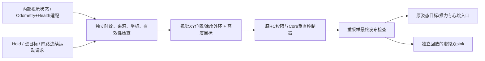

# 视觉导航开发验收记录（2026-10-31）

本地原目录没有 Git 历史，本次将现存导航修复源码导入为 `navigation-repair-20261031` / `6b440ab`，随后在 `feature/vision-navigation` 开发。该提交代表本地源码快照，不是香橙派运行二进制的校验值。用户提供的当前部署目录为 `/home/orangepi/FC01_OrangePi_Navigation_20261031_fixed`；本轮没有切换该目录的服务或修改飞控参数。

## 已实现的控制链

内部数据合同、所有字段/坐标/候选参数和操作方法见 [视觉导航说明](VISION_NAVIGATION.md)。角速度可接收并标明来源，但本轮没有新增角速度内环；快速姿态与垂直反馈仍由 PX4 提供。Follow 接受视觉方转换后的四路运动请求，不包含视觉检测器、识别器或目标选择算法。

## 本机结果

| 验证 | 证据 | 结论范围 |
| --- | --- | --- |
| 修改前基线 | 115 项完整测试通过 | 已有导航修复作为本地基线 |
| 最终完整回归 | `python3 -m unittest discover -s tests -v`，160 项 / 49.923s / OK | 包括原生、适配器、配置、回放、安装生命周期 |
| 原生 C++ | `python3 tests/run_native_cpp.py`，56 个可执行回归通过 | 真实 Runtime/Core/权限/最终边界，不是 Python 复制控制公式 |
| ROS API 夹具 | `python3 native/tests/adapter_compile_check.py` 通过 | 语法/API 检查，单独不证明 ROS 链接 |
| 真实 Humble/FC01 SDK | 自定义4消息生成；节点和配置检查器编译、链接、安装通过 | 本机 x86_64，不是 ARM64 实机构建 |
| 安装运行库 | 只加载 Humble+原 SDK 后 `ldd` 无缺失；Node 与消息库均有 `$ORIGIN:$ORIGIN/..` RUNPATH | 修复新增私有消息库在原启动环境中不可见的问题 |
| 实际 YAML 消费 | enabled 接受；越原倾角、无RC路由、自动arm拒绝；disabled旧严格限幅接受 | 真实 rclcpp 配置检查器，无飞控输出 |
| 真实 ROS 适配链 | `tests/ros_vision_smoke.py`，`REAL_ROS_VISION_ADAPTER_PASS` | 合成 Odometry+Health→真实 ROS 回调→规范化状态；ENU/速度转换、多源撤销通过，adapter无 `/fmu/in/**` publisher |

实际构建使用 `/opt/ros/humble` 与本机原 FC01 SDK `/home/jikl62/FC01_R632_P0_ATTITUDE_AUDIT_CANDIDATE/install_r632`；安装前缀 `/tmp/fc01_vision_ros_20261031/install`。没有用不兼容的电脑通用 px4_msgs 替代原 SDK。

## 理想闭环结果

`python3 vision_replay.py --demo cruise`：180个控制周期、9秒模拟，水平目标 `[0.8,0.4]m` 的 **XY误差**从 `0.894427m` 降至 `0.000843m`；全部目标/心跳均实际进入虚拟最终 sink，自动 Arm/进入 Offboard 命令计数均为0。原高度目标0.5m下，演示末尾高度约0.477259m，不能把水平误差数值称为三维误差。

`--demo height`：原0.5m高度向0.9m目标运动，9秒末约0.882674m，原控制器计算的推力幅值约 `0.475130…0.497249`。推力由原垂直 PID 计算，没有换用演示专用 PID。

模型仅假设理想姿态跟踪、hover对应重力和简单阻尼；这些结果验证反馈闭环代码及限幅路径，不能作为实际精度、稳定性、动力标定或可飞证据。`position_error` 字段为水平 XY 误差，Z 响应用 `height/target_height` 分别观察。

## 审查修复

独立审查与限定复核已完成，没有剩余 Critical/Important 阻断项。以下问题均先复现再回归修复：

- 首次 target 真正提交之前 TTL 刚过期：返回无提交的任务拒绝，进入原生下降；target 已提交后的变化保留原 partial-sink 硬故障。
- 来源/坐标/epoch重启同时序号回退：本地撤销代次不能被去重吞掉；A→B→A也不能续旧目标。未激活的正常初始化恢复仍可开始。
- 关闭视觉时，新默认候选限幅不能阻断更保守的合法旧配置。
- 原始 Odometry/Health 各须唯一发布者；适配器不能掩盖上游冲突，撤销时清缓存并发显式无效状态。
- 新 ROS 消息共享库的安装 RPATH，确保原启动环境可以找到本包依赖。

原 `native/config/attitude_altitude.yaml`、`VerticalController`、垂直反馈保护、RC 启动汇合逻辑、authority、导航档位设置、服务安装和 boot 文件与基线逐字节一致。扩展发生在显式默认关闭的视觉配置、Core目标计算、最终许可、ROS订阅和适配/回放工具。

## 交付与待验收

代码保留在开发分支，合并范围和本地/已有主仓库处理方法见 [合并说明](VISION_NAVIGATION.md#修改与合并)。默认 `vision_settings.json` 为 `enabled=false`，不会因源码合并自动开始视觉运动。

尚待真实设备完成：新相机话题/类型/频率/QoS、测量时钟、尺度与外参/PX4航向对齐、健康/重置约定、真实图和资源负载、ARM64构建与服务运行、原起飞准备/实际自主飞行，以及实机定点/巡航/连续跟随验收。所有仓库视觉回放均为 synthetic；目前没有新相机录制数据。

本机日志保存在 `/tmp/fc01_vision_final_suite_20261031.log`、`/tmp/fc01_vision_ros_final_build_20261031.log`、`/tmp/fc01_vision_installed_ldd_20261031.log`。运行命令和新视觉方待补清单在用户说明中。
