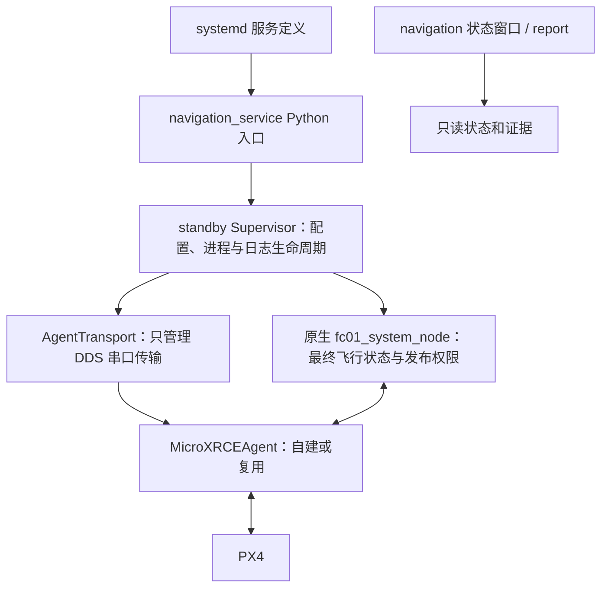

# 先理解谁拥有控制权，再读 Python 的流程

这套工程的 Python 主要负责入口、进程托管、配置和取证。真正决定是否发送目标姿态/推力的是原生控制器的状态机和最终发布检查；PX4 再执行自己的控制与保护。服务显示 `active` 只能说明进程在运行，不能推出飞控数据新鲜、已经解锁或可以起飞。

## 四层进程关系

`systemd` 根据 unit 启动入口并管理服务寿命；它不知道当前飞机状态。`Supervisor` 是长期运行的监督器，创建或复用 Agent，启动并监看本轮原生进程，持续接收状态。`Agent` 负责把 ROS/DDS 与串口另一端接起来，它不是起飞任务控制器。Agent 断开时，只恢复传输，不能替换仍活着的原生进程来清掉故障，也不重放上轮起飞任务。

`launcher.py` 是另一条交互会话入口。它与正式导航服务共用协作启动锁，不能各自再启动一套控制器。`native/tools/start.py/fcctl.py` 是原生工具链入口，要区分它们与正式导航部署；读到 `ARM` 或 `VEL` 函数不等于运行状态窗口会发送这些命令。本轮只改注释，没有运行这些控制入口。

## 一条配置如何到达控制器

先读 `navigation_service.candidate_config_path → load_profile → navigation_profile`。依赖 SDK 路径和当前 entry 路径职责不同：SDK 提供环境/类型，entry 提供这次要运行的控制器和源 YAML。不能因为旧 SDK 内有可执行程序，就把它当作当前源码构建结果。

`load_profile` 先验证基础配置，再读 `navigation_settings.json`。目标高度取显式设置，否则用原默认 1.5 m；模式档位先取设置，再取基础 YAML，仍缺失才用 `load_profile` 内部兜底值 6，并显式传给 `navigation_profile`。直接调用 `navigation_profile` 时省略档位参数，才采用其签名中的默认值 6。这两个默认都不代表当前配置实际一定是 6。返回对象还附带来源路径、入口版本等身份，身份不是动作许可。

`diagnostic_profile` 关闭动作门和视觉门；`navigation_profile` 的人工 RC 路线保留总动作门和起飞门，程序自动 arm 继续关闭。`flight_enabled`、`arm_enabled`、`takeoff_enabled`、`visual_navigation_enabled` 是不同字段，不能互相替代。`runtime_profile` 深拷贝基础字典，避免给下一轮留下被原地改过的基础配置。

监督器每轮现调用配置工厂，写本轮 `runtime.yaml`，然后把该路径交给原生进程。Python 写出候选 YAML，只代表参数准备；原生仍须收到有效数据、取得 RC 与任务条件，并经过最终发布检查。`navigation_restore.configure` 安装/enable 定义与 `activate` 立即运行也是不同动作；都不能从名字推断已经获得起飞许可。

## 资源所有权与退出

| 资源 | 谁拥有、如何释放 | 不能作的推断 |
|---|---|---|
| 复用 Agent | 保存经过检查的进程事实，不获得终止权 | 名字相同/PID 相同不是自建句柄，也不是永久身份。 |
| 自建 Agent | 本次 `Popen` 的持有者；原生退出后仍须取得新鲜未解锁接地证据才可请求终止 | `terminate()` 返回或 `finish_agent=True` 不保证子进程已经退出。 |
| 原生控制器 | 会话/监督器负责请求优雅退出并保留恢复通道 | UI 关闭、IPC 失败、超时不允许直接强杀或再启第二套。 |
| Channel/socket | Channel 借用传入 Socket；外层会话负责关闭 | TCP/Unix 一次 read 不等于一条 JSON；已部分发送不能重试整条命令。 |
| IPC 空目录 | `make_socket_path` 创建后成功移交外层；拒绝长路径则清理本次空目录 | 不删除旧会话或其他人的 Socket 来绕过冲突。 |
| Evidence events | Evidence 构造打开 `console.jsonl`；外层调用 `evidence.events.close()` | Evidence 本身没有 `close()` 方法。 |
| 日志泵和 writer | 每个泵只持本轮 stream/handlers，长期 writer 有自己的队列 | 有限 join 不保证阻塞 daemon 已退出；旧泵不能关下一轮新处理器。 |
| ROS Node/executor | 被动探针拿到对象后在退出链逐项释放 | 基类构造未返回时，不存在应用层已取得的完整 Node。 |
| 默认 ROS Context | 仅本次 init 前尚未活动时登记为自有 | 重复 init 失败不能因此关闭调用者原本活动的 Context；该工具不是并发 Context 管理器。 |

停止信号先改变一个共享停止标记，主循环再按原次序请求退出。监督器等待仍活着的原生结束，是保留其安全托管和取新证据的责任，不是为了掩盖错误而无限重试。本轮若已取得原生句柄，先等原生结束，才进入可中断的 30 秒退避；尚未取得原生句柄的启动失败也可退避。Agent 的恢复同样没有任务重试权限。

`standby._close_supervised_attempt` 当前并没有“任意清理失败仍完成全部后项”的保证。不要把 `finally` 误解成其中每一行一定执行：如果第一条清理调用自己抛错，后面的普通语句仍会被跳过。这部分涉及活进程托管，本轮保留为候选，后续先建故障注入再改。

## 怎样读函数和异常

`with open(...) as stream:` 表示该代码块结束时交由上下文管理器关闭 stream，异常退出也会调用关闭；它不保证此前未成功取得的资源可以被释放，也不保证 `close()` 永远不抛错。`try/finally` 表示正常和异常都尝试进入 finally，不能自动解决 finally 内多项动作互相打断的问题。

`run=subprocess.run` 是可注入参数：正式运行默认执行外部命令，单元测试传替身记录 argv/结果。看到测试中的 `activate` 并不能认定测试真的启动了服务；应继续查看传入的 runner、fake process 和被 patch 的入口。本轮静态 `systemd-analyze verify` 读取临时 unit，不会 enable/start 服务。

`owned`、`created`、`None` 是不同用途的水位。`created=False` 在独占创建真正成功后才改 True，使 finally 只清本次资源；变量是 None 表示还没拿到资源句柄，不能对它调用 destroy。`except ...: raise` 保留错误，和 `except ...: pass` 完全不同。被动探针记录原业务错误，收集次生清理错误并链接，不把清理失败打印后当作成功。

lambda 在这里主要封装“稍后无参调用某个释放动作”；闭包捕获的是当前函数中的对象引用。`nonlocal` 让内部函数修改外层会话变量，例如 Launcher 的 `closing/outcome`，不是新建一个同名局部变量。字典的浅复制或 `_summary()` 不会深拷贝嵌套状态：列表原地 clear/append 和把字段重新绑定为另一个列表，其效果不同。三处摘要仍在原时点创建，正是为了保持这些含义。

## 状态和报告怎样避免误读

先读 `navigation_status.controller_state_current`，再读每种反馈的新鲜度计算。外层 Supervisor PID、原生 PID、boot/session、状态年龄只解决“是不是当前会话”；某个话题仍可能源样本过期。收到新 JSON 不表示其中旧 `VehicleLocalPosition` 自动变新，也不能用最近的历史 Stabilized/armed=False 直接当成当前接地许可。

`navigation_report` 按固定顺序收配置/身份、小文件、日志、末尾状态和只读查询；它不是原子快照，也不会为了报告去请求 LAND 或 arm。两个状态文件可能不同，采集索引会记录变化。单个源文件失败按原合同记录 UNAVAILABLE；ZIP 最终关闭等外层错误仍向外传播，不能把所有错误都改成“继续”。

`_record_status_identity` 只是解析已经捕获的字节，不再次读盘。间接 `running_entry` 同时过词法和真实归属检查；明确由调用者传入的 invoked entry 保留既有合同。NOFOLLOW 只管末级链接，不自动保护所有父目录竞争。报告内容的 SHA 是实际收下的字节，裁尾后不能冒称完整原日志的 SHA。

`feedback_age_probe` 同时观察墙钟微秒、本机单调秒、消息 envelope/sample 微秒和 RMW 接收纳秒。墙钟用于源年龄，单调钟用于窗口/期限，二者不能交换。没有确认时钟 epoch 前，host 减 RMW 只是一项诊断，不能称纯 DDS 排队时间。`StampProgress.previous` 保存上一次非缺失观测，回退后也会更新，不是只增不减的防重放水位。未知数字用 None，而不是补 0 冒充有效状态。

## 三处结构整理的读法与测试入口

1. `navigation_build_evidence._native_build_commands`：输入四个当前对象，返回三组 argv；不读文件、不执行命令。`build_release` 仍负责锁、复用、建 stage、执行、再验输入和发布。install 链接与证据 JSON 是两次替换，不是联合原子事务。
2. `navigation_report._record_status_identity`：输入 capture 索引与状态 bytes，返回 row，原地填两块内存索引；没有服务或控制副作用。无效 JSON 回落空观测，其余异常按原边界传播。
3. `launcher.Evidence._summary`：输入 outcome，返回当次新字典；last_state/first_failure/truncated 是对象引用。checkpoint/report 仍掌握实际 I/O 和错误处理，不让 helper 隐藏归档时机。

新测试以 `tests/test_overnight_stage4_*.py` 为入口；其中 deployment/reporting/launcher_readability 从不可变 Git 对象加载旧实现，比较真实临时文件、顺序和异常，而不是只比较 helper 的手写期望。tools 使用假 ROS 注入失败点，单独的真实 Humble smoke 再验证正常通信；两者覆盖不同证据。完整命令与原始日志见本目录证据索引。

保留长协调函数不代表不再优化。后续应先确认某个新 helper 的输入/输出、可见副作用、异常和调用时点，再用原流程重放对照。涉及飞行权限和活原生托管的行为变化必须独立处理，不能藏在注释、函数拆分或“错误恢复”里。
